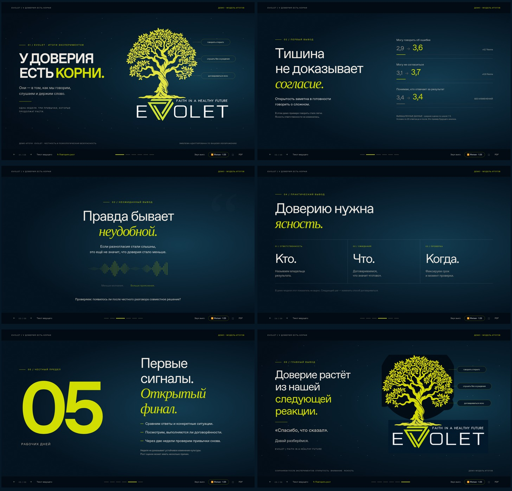

# EVOLET — У доверия есть корни

**6 кинематографических сцен** с итогами недельных экспериментов о честности, доверии и психологической безопасности.

Вступление: три световые линии проходят по контуру эмблемы и продолжаются в корни, ствол и ветви. Из лаймовой эмблемы **EVOLET** вырастает могучее дерево с витым стволом, густой кроной и широкими корнями — по присланному образцу. На его ветвях появляются три привычки: **говорить открыто**, **слушать без осуждения**, **договариваться ясно**. В финале выросшее дерево возвращается с фразой «Спасибо, что сказал. Давай разберёмся».

> Все результаты и числовые показатели — **ДЕМО**. Реальные данные ещё не добавлены.

## Посмотреть и скачать

- **[Весь комплект — ZIP](https://github.com/jalaevf-ai/presentation/raw/refs/heads/main/downloads/pravo_na_pravdu_complete.zip)**
- [Рост из линий эмблемы — 12 секунд, обычная скорость](https://github.com/jalaevf-ai/presentation/raw/refs/heads/main/downloads/growth_detail.mp4)
- **[Фильм с музыкой — MP4](https://github.com/jalaevf-ai/presentation/raw/refs/heads/main/downloads/pravo_na_pravdu_film.mp4)**
- [PDF — 6 страниц](downloads/pravo_na_pravdu.pdf)
- [PowerPoint — 6 статичных слайдов](https://github.com/jalaevf-ai/presentation/raw/refs/heads/main/downloads/pravo_na_pravdu.pptx)
- [Автономная презентация HTML](https://github.com/jalaevf-ai/presentation/raw/refs/heads/main/index.html)
- [Сценарий выступления примерно на 4 минуты](presenter_script.md)
- [Анимированное превью](preview.gif)

Скачайте `index.html` и откройте в Chrome, Edge, Firefox или Safari. Всё встроено: музыка, изображения и шрифты. Интернет для показа не требуется. Просмотр HTML-кода в GitHub не запускает презентацию. GitHub Pages пока не настроен.

## Управление

- **← / → / пробел** — сменить сцену.
- **F** — полный экран.
- **N** — заметки ведущего.
- **R / «Повторить рост»** — заново проиграть дерево на первой или последней сцене.
- **«Пауза / Продолжить»** — остановить и продолжить анимацию с того же места.
- **«Фильм»** — автопоказ на 1:25.
- **«Звук»** — включить музыку во время автопоказа.
- **PDF** — печать всех сцен.

Видео содержит музыкальную дорожку без дикторской озвучки. PDF и PowerPoint — запасные варианты без анимации; слайды PowerPoint сохранены изображениями.

## Содержание

1. EVOLET: из эмблемы вырастает дерево доверия.
2. Тишина не доказывает согласие: смешанные демо-результаты.
3. Правда бывает неудобной.
4. Доверию нужна ясность: кто, что, когда.
5. Пять рабочих дней: первые сигналы и пределы выводов.
6. Доверие растёт из нашей следующей реакции.

## Фирменное оформление

Использована визуальная адаптация присланной эмблемы EVOLET: тёмно-синий фон, белое название и лаймовый знак. [Официальный сайт компании](https://evolet.tj/) предоставлен пользователем; его содержимое не удалось прочитать из-за сетевых ограничений среды. Данные о компании не выдумывались. [Адаптированная эмблема](brand/evolet_logo.png). [Дерево по образцу](brand/evolet_tree.png).
